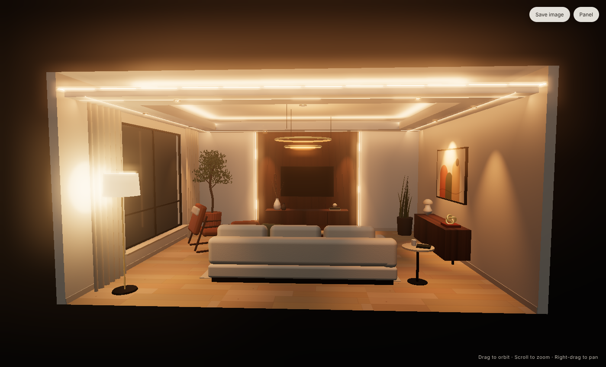
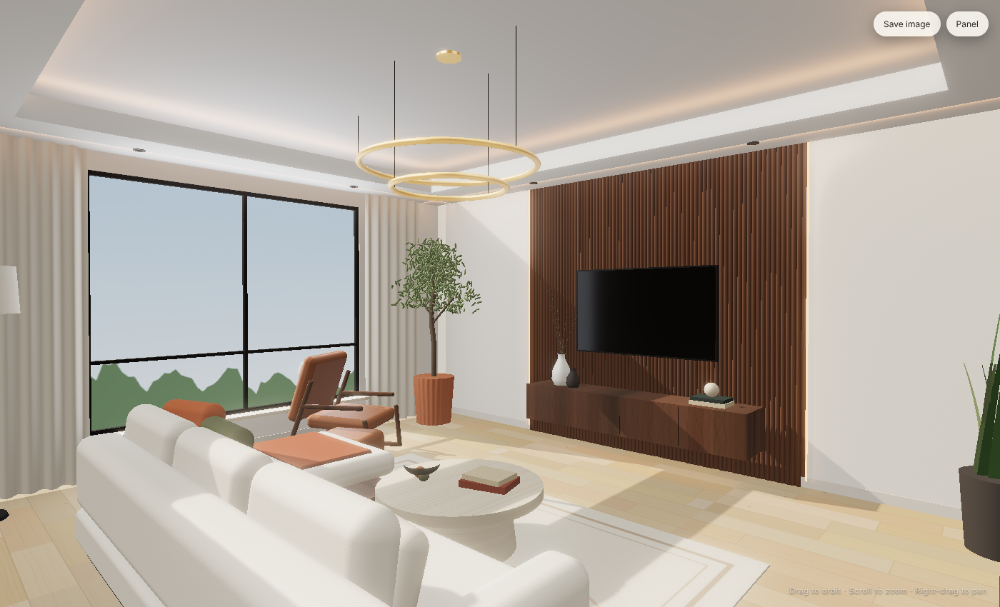

# Tiken Interior — Living Room with Floating Cove Ceiling

An interactive 3D interior concept for a 6.0 × 5.0 m living room. The design is built around the ceiling: a dropped
gypsum band frames a raised centre field, a hidden LED cove washes that field with light, and a shadow-gap LED line
runs around every edge of the room.

**Open `index.html` in any modern browser.** It works offline by double-clicking; no server is needed.


| Ceiling detail | Cut-away section |
|---|---|
|  |  |
| **Day** | **Cinema** |
|  |  |

## Ceiling design

| Element | Specification |
|---|---|
| Perimeter band | 2 × 12.5 mm gypsum board on metal furring, 700 mm wide, underside at **2700 mm** |
| Raised centre field | Left at slab height (≈3000 mm), giving a 300 mm step |
| Cove light | 24 V COB LED tape, 14 W/m, tunable white 2200–6500 K, in an aluminium channel set 60 mm behind a 70 mm upstand so no LED dots are visible |
| Edge light | 60 mm shadow gap between band and wall on all four walls, with an LED profile and opal diffuser. It grazes the walls and the fluted walnut panel, and also hides the curtain track |
| Downlights | 8 × trimless 7 W, 2700 K, CRI 95: 22° beams grazing the TV wall, 36° elsewhere, one aimed at the artwork |
| Pendant | Twin brass ring halos (Ø1100 / Ø720) over the coffee table |
| Control | 5 dimmable circuits (DALI-2 / Casambi) with **Day · Evening · Cinema** scenes |

## Room concept: "Warm Minimal"

- **Palette:** warm limewash walls, soft-white ceiling, walnut, oak, bouclé, travertine, with terracotta and olive accents.
- **TV wall:** full-height fluted walnut panel (2.8 m) with vertical LED reveals, a floating walnut console with an under-glow, and a 65" TV.
- **Seating:** L-shaped bouclé sofa, a travertine drum table with a nested walnut table, and a 3.2 × 2.4 m wool rug.
- **Reading nook:** cognac leather lounge chair and ottoman by the window, an olive tree, a linen drum floor lamp, and full-height linen drapes.
- **Art wall:** a low walnut credenza and a framed abstract, lit by an adjustable downlight.

## Using the viewer

- **Lighting scene:** Day / Evening / Cinema
- **Circuits:** switch the cove, edge light, downlights, pendant, accent LEDs and floor lamp on or off
- **LED colour:** colour-temperature slider, brightness, and mood colours (amber, rose, lavender, ocean)
- **Views:** living, ceiling detail, TV wall, reading nook, and a cut-away section that shows the ceiling profile
- **Save image** exports a PNG of the current view
- Deep links work, e.g. `index.html?scene=cinema&view=ceiling`

## Development

```bash
npm install
npm run build     # bundles src/ → dist/room.bundle.js
```

The source is in `src/main.js` (scene, ceiling, lighting) and `src/textures.js` (procedural materials). All textures are
generated in code, so the project has no image dependencies.
