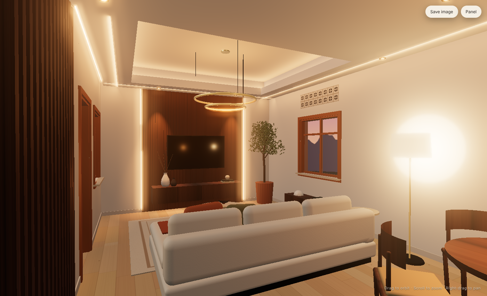
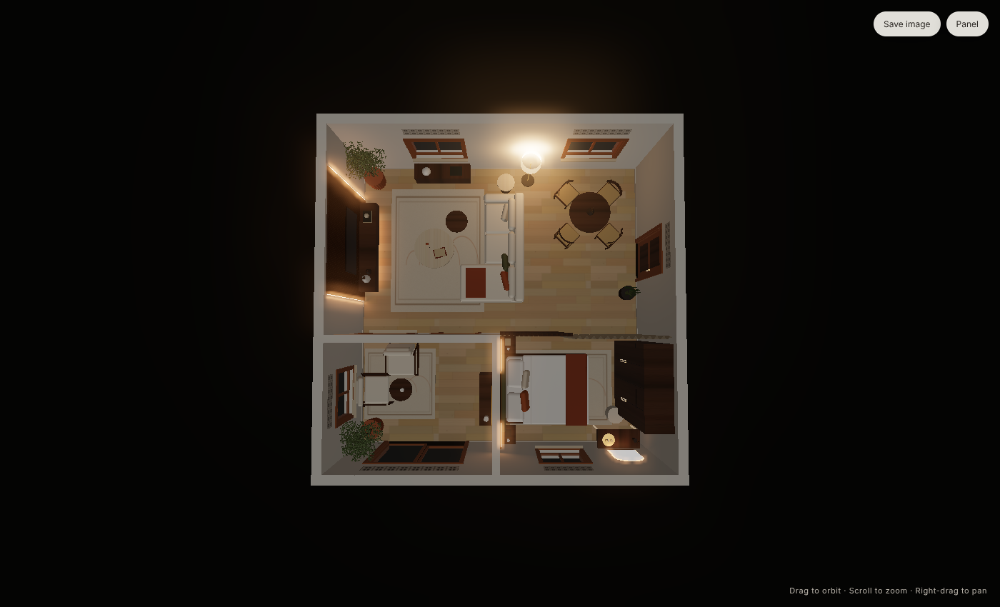
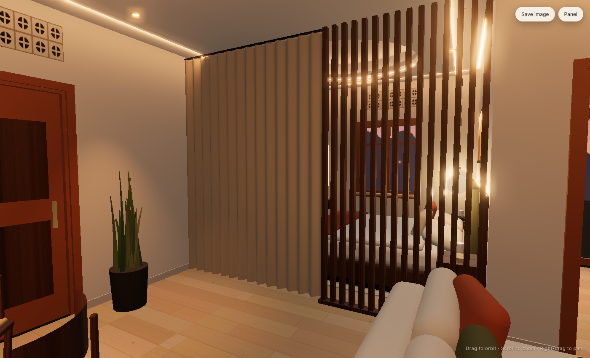
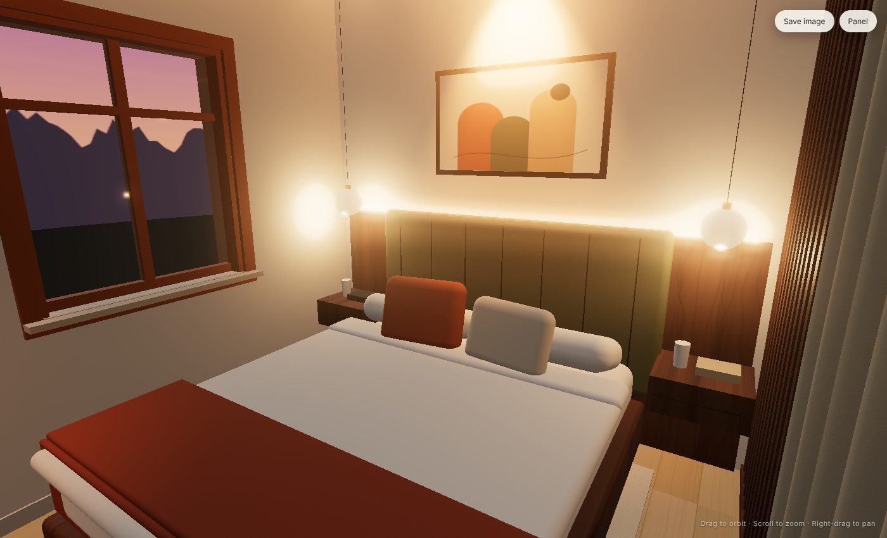
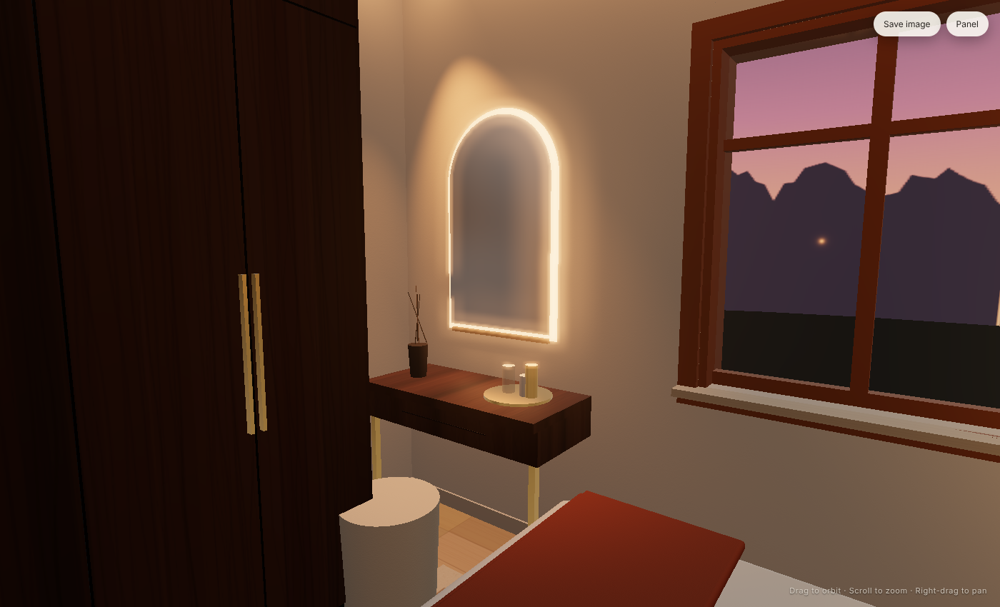
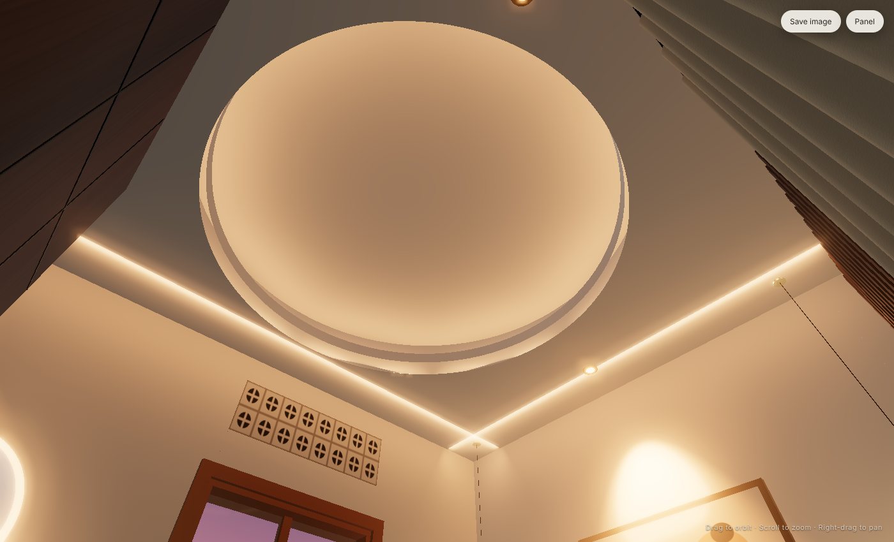
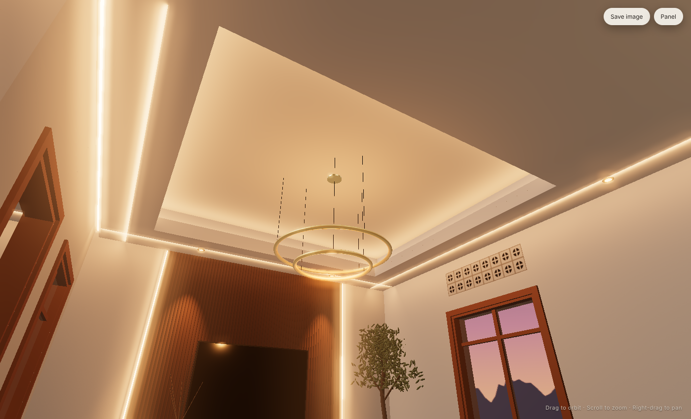
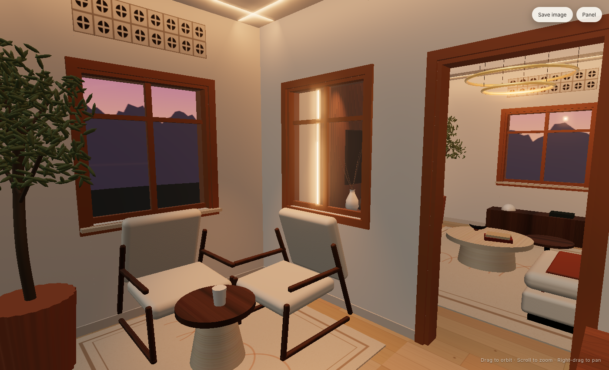
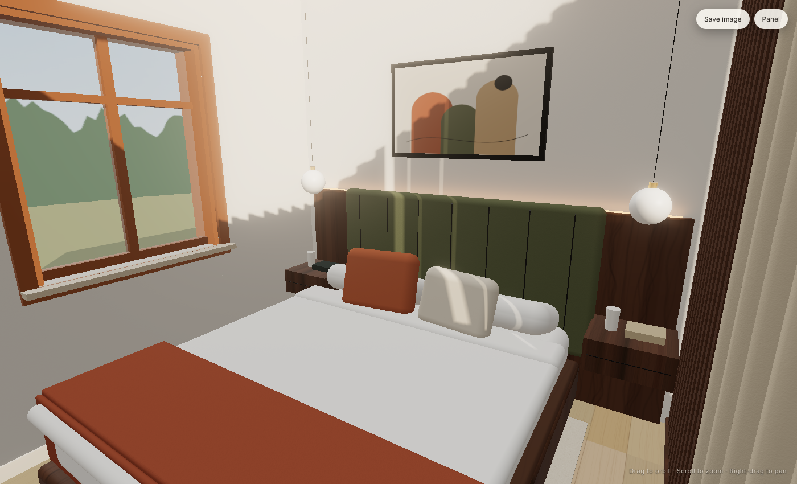
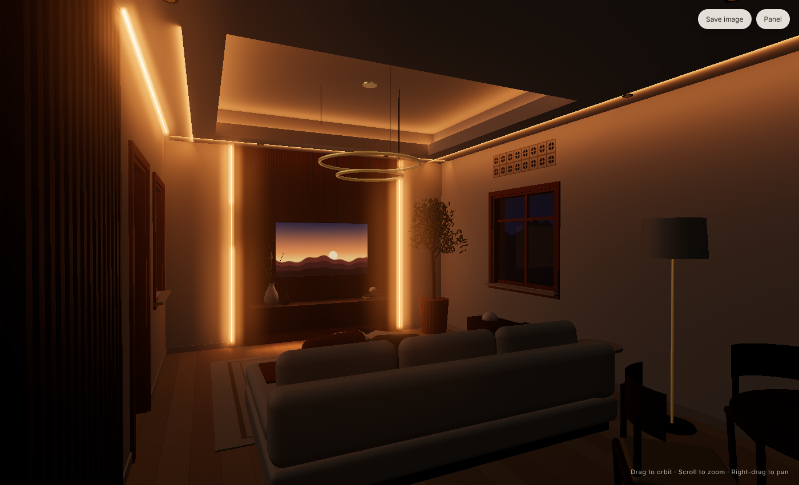

# Tiken Interior — 23′ × 23′ House: Living Room, Bedroom & Front Room

An interactive 3D interior design for the house on site: block walls, teak window and door frames, breeze-block vents,
and an open hip roof on timber rafters. The design hangs a new suspended ceiling below the roof. It has a raised tray
over the living room, a circular dome over the bed, and an LED edge light that runs around every wall.

**Open `index.html` in any modern browser.** It works offline by double-clicking; no server is needed.



## Layout (from the site measurements)

| Space | Size | Use |
|---|---|---|
| Hall (long part of the L) | 23′ × 14′ | Living room: TV wall, sofa, plus a compact dining table for four by the rear window |
| L-extension | 11′ × 9′ | Bedroom: queen bed, built-in wardrobe, dressing table |
| Front partition | 11′ × 9′ | Entrance lounge with glazed teak sliding doors |

**Living / bedroom partition:** 5′ of fixed vertical walnut slats, so light passes through while the bed stays screened.
The remaining 6′ is a full-height linen curtain on a track recessed into the ceiling. Close it for privacy; open it and
it stacks against the wall. The curtain can be opened and closed in the viewer.



| Partition (slats + curtain) | Bedroom |
|---|---|
|  |  |
| **Dressing table** | **Bedroom ceiling dome** |
|  |  |
| **Living ceiling tray** | **Front room** |
|  |  |
| **Bedroom – day** | **Living – cinema** |
|  |  |

### Bedroom

- **Bed:** queen bed (5′ × 6′-8″) on a walnut platform, against the solid wall shared with the front room. The headboard is channel-tufted in olive, on a walnut panel with a hidden LED strip along its top edge.
- **Bedside:** floating walnut nightstands, each with a small globe pendant hanging above it.
- **Wardrobe:** a full-height 6′ built-in walnut wardrobe with brass pulls, on the right wall.
- **Dressing table:** a floating walnut table with drawers and brass legs, an arched mirror with an LED halo, and a bouclé stool, by the front window.
- **Ceiling and lighting:** a circular dome with a cove light sits over the bed, and a downlight is aimed at the artwork above the headboard.

## Ceiling specification

| Element | Specification |
|---|---|
| Suspended ceiling | 12.5 mm moisture-resistant gypsum on a galvanised steel grid, hung from the rafters and wall plate. Underside at **2850 mm (9′-4″)** |
| Insulation | 50 mm glass wool laid on top of the ceiling, to keep heat from the metal roof sheets out of the rooms |
| Living tray | Rectangular opening with a 600 mm (2′) border band, rising 400 mm into the roof void to 3250 mm (10′-8″) |
| Bedroom dome | Ø2.0 m opening over the bed, Ø2.4 m drum, same 3250 mm height |
| Cove light | 24 V COB LED tape, 14 W/m, tunable 2200–6500 K, hidden behind a 70 mm upstand in both the tray and the dome |
| Edge light | 60 mm shadow gap with an LED profile and opal diffuser around every wall of the living room, bedroom and front room (≈ 38 m) |
| Curtain track | Recessed ceiling track along the living/bedroom line, set into the ceiling band |
| Downlights | 15 × trimless 7 W, 2700 K, CRI 95: two grazing the TV wall, one on the bedroom artwork, one on the dressing table |
| Pendants | Twin brass rings over the coffee table, three opal globes over the dining table, two small globes beside the bed |
| Ventilation | The existing breeze-block vents stay visible below the ceiling line. The roof void gets its own eave vents |
| Control | 5 dimmable circuits with **Day · Evening · Cinema** scenes |

## Finishes

- **Walls:** plastered and finished in warm limewash.
- **Frames:** the existing teak window and door frames are kept and oiled.
- **Floor:** wood-look porcelain plank laid over the existing concrete slab.
- **TV wall:** fluted walnut with LED reveals.
- **Palette:** bouclé, travertine and walnut, with terracotta and olive accents.

## Using the viewer

- **Lighting scenes:** Day / Evening / Cinema.
- **Partition:** open or close the bedroom curtain.
- **Circuits:** switch the cove, edge light, downlights, pendants, accent LEDs and lamps on or off.
- **LED colour:** colour-temperature slider, brightness, and mood colours.
- **Views:** living room, living ceiling, partition, bedroom, dressing table, bedroom ceiling, dining corner, front room, floor plan, and cut-away section.
- **Save image:** exports a PNG of the current view.
- **Deep links:** for example `index.html?scene=evening&view=bedroom`.

## Development

```bash
npm install
npm run build     # bundles src/ → dist/room.bundle.js
```

The scene, walls, ceiling and lighting are in `src/main.js`; the procedural materials are in `src/textures.js`. Plan
dimensions are constants at the top of `src/main.js`, so they are easy to adjust if site measurements change.
